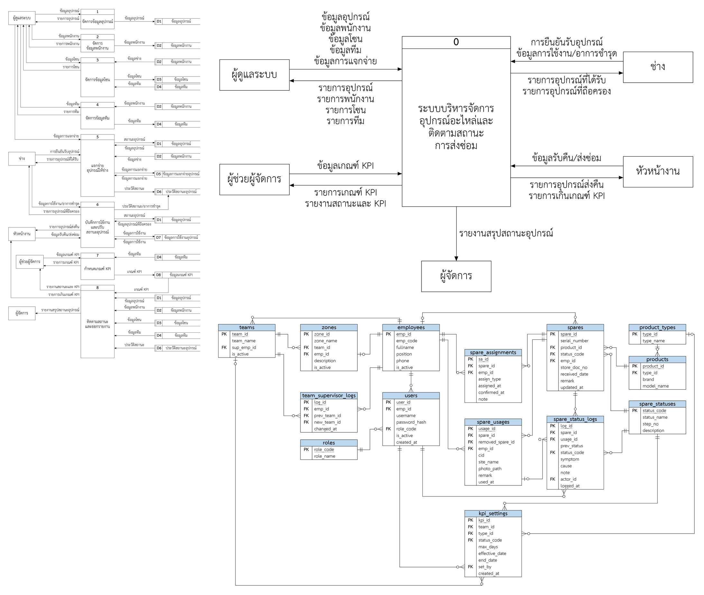

# Skill DFD ER With Mangkon

> **ตั้งแต่ v3.0 skill นี้คือ "กฎการทำงานหลัก" ที่ต้องอ่านก่อนเริ่มงานทุกงาน** (ไม่ใช่แค่งาน DFD/ER):
> กฎทั่วไป (ตอบภาษาไทย สำรองก่อนแทนที่ ไม่ทับงานผู้ใช้ ตรวจไฟล์ล็อก `~$` ตรวจผล ใช้ของที่มีอยู่ก่อน)
> + Step 0 ตรวจชุดเครื่องมือ (Ponytail, Graphify, Anthropic document-skills) + กฎ DFD/ER ทั้งหมด

Skill สำหรับออกแบบ วาด ตรวจ และใส่รูปเล่ม **Context Diagram, DFD Level 1/2, ER Diagram (Crow's Foot), Data Dictionary และ MariaDB DDL**
ตามหลัก "ข้อมูลต้องมีที่มาที่ไป" สำหรับรายงานโครงงาน/ปริญญานิพนธ์ภาษาไทย ใช้รูปแบบ [Agent Skills](https://agentskills.io)
จึงติดตั้งจาก URL เดียวกันได้กับตัวช่วย AI ที่รองรับสกิล เช่น Cursor, Claude Code, Codex, Gemini CLI, GitHub Copilot, Windsurf, Cline และตัวอื่นที่ตัวติดตั้งรองรับ



## มีอะไรบ้าง

- **กฎทั้งหมด** ที่ใช้ทำรายงานจริงจนผ่านการตรวจของอาจารย์: ตรรกะข้อมูล ลำดับ process ขนาดกรอบ เส้น ฟอนต์ การโยงเส้น สี caption เลขหน้า
- **ไฟล์ต้นฉบับ** Visio (.vsdx) และ PNG ของ Context, DFD Level 1, Level 2 (2 รูป) และ ER ที่แก้แล้ว (กล่องกลวงไม่บังตัวอักษร หัวตาราง ER สีฟ้า)
- **ตัวสร้างรูป** (Python) ที่อ่าน spec JSON แล้วสร้าง .vsdx + .png ตรงกับต้นฉบับทุกไบต์ พร้อม test
- **เครื่องมือตรวจ**: CRUD matrix, balancing, black hole/miracle, FK ↔ เส้น ER, ไฟล์ Visio
- **Data Dictionary** แม่แบบ .docx รูปแบบเดียวกับเล่ม และตัวสร้าง SQL DDL สำหรับ MariaDB

```
skills/dfd-er-design/
  SKILL.md                     ส่วนที่ 1 กฎทั่วไป + Step 0 (ทุกงาน), ส่วนที่ 2 workflow DFD/ER
  docs/                        toolchain, principles, dfd-style, er-style, report-insertion, checklist
  templates/                   vsdx/ png/ generator/ dd/ sql/ tools/ bootstrap/  (ดู templates/README.md)
  examples/spare_part_design.md   สรุปการออกแบบตัวอย่าง (14 ตาราง)
  references/chapter3_example.docx บทที่ 3 ฉบับจริง
  evals/                       test prompts
install.ps1 / install.sh       ติดตั้งแบบ global + เพิ่มคำสั่ง "อ่าน skill นี้ก่อนทุกงาน"
CLAUDE.md, AGENTS.md, .cursor/rules/load-dfd-er-design.mdc   bootstrap เมื่อทำงานในรีโปนี้
```

## ชุดเครื่องมือที่ skill แนะนำ (Step 0)

สรุปจาก [ลง Claude Code แล้ว ติดตั้ง 3 ตัวนี้ก่อน (และ 1 ตัวที่ไม่ควรลง)](https://aismartworkth.com/guide/claude-code-first-3) โดย AI Smart Work
รายละเอียดครบใน [docs/toolchain.md](skills/dfd-er-design/docs/toolchain.md) skill นี้ **ไม่ได้รวมซอร์สของเครื่องมือเหล่านี้** ให้ติดตั้งจากแหล่งทางการ

| เครื่องมือ | ติดตั้ง (Claude Code, ส่งทีละบรรทัด) |
|---|---|
| [Ponytail](https://github.com/DietrichGebert/ponytail) (MIT) ใช้ของที่มีอยู่ก่อน โค้ดน้อยลง | `/plugin marketplace add DietrichGebert/ponytail` แล้ว `/plugin install ponytail@ponytail` |
| [Graphify](https://github.com/Graphify-Labs/graphify) (Apache-2.0) แผนที่โปรเจกต์ใหญ่ | `uv tool install graphifyy` แล้ว `graphify install` แล้ว `/graphify .` |
| [Anthropic document-skills](https://github.com/anthropics/skills) (source-available) Word/Excel/PowerPoint/PDF | `/plugin marketplace add anthropics/skills` แล้ว `/plugin install document-skills@anthropic-agent-skills` |
| ~~OmniRoute~~ | **ไม่แนะนำ**: ถือ key ทุกเจ้า เห็นทุกข้อความ/โค้ด แก้ข้อมูลระหว่างทางได้ คุณภาพไม่คงที่ |

## ติดตั้งให้ทุก AI

คำสั่งนี้ติดตั้ง skill `dfd-er-design` ทั้งเครื่อง ให้ทุกตัวช่วยที่ตรวจพบ โดยไม่ต้องตอบคำถามเพิ่ม

```bash
npx skills add https://github.com/mangkon1/Skill-DFD-ER-With-Mangkon --skill dfd-er-design --agent '*' -g -y
```

เปิดแชทใหม่หลังติดตั้ง แล้วบอกให้ช่วยออกแบบหรือตรวจ DFD, ER Diagram หรือ Data Dictionary

ติดตั้งเฉพาะโปรเจกต์ปัจจุบัน โดยไม่ใส่ `-g`

```bash
npx skills add https://github.com/mangkon1/Skill-DFD-ER-With-Mangkon --skill dfd-er-design --agent '*' -y
```

ใน Cursor ติดตั้งจากหน้าจอได้เช่นกัน เปิด Customize แล้วเลือกนำเข้าจาก GitHub repository จากนั้นวาง `https://github.com/mangkon1/Skill-DFD-ER-With-Mangkon` แล้วติดตั้ง plugin `dfd-er-design`

ติดตั้งเอง: คัดลอกโฟลเดอร์ `skills/dfd-er-design` ไปไว้ในโฟลเดอร์ skills ของเครื่องมือที่ใช้ (เช่น `~/.cursor/skills/`, `~/.claude/skills/`)

## บังคับให้อ่าน skill นี้ก่อนทุกงาน

ตามมาตรฐาน Agent Skills ตัวช่วย AI เลือกโหลด skill จาก `description` เอง **จึงบังคับ 100% ด้วย skill อย่างเดียวไม่ได้**
description ของ v3 เขียนว่า MUST load ก่อนทุกงานแล้ว แต่ให้ได้ผลจริงต้องเพิ่มคำสั่งในไฟล์ที่ตัวช่วยโหลด **ทุก session เสมอ**:

| ตัวช่วย | ไฟล์ที่โหลดทุก session | วิธีตั้ง |
|---|---|---|
| Claude Code | `~/.claude/CLAUDE.md` (ทุกโปรเจกต์) หรือ `CLAUDE.md` ในโปรเจกต์ | สคริปต์ติดตั้งเพิ่มให้ หรือวางข้อความจาก `templates/bootstrap/CLAUDE.md` |
| Codex | `~/.codex/AGENTS.md` (ทุกโปรเจกต์) หรือ `AGENTS.md` ในโปรเจกต์ | สคริปต์ติดตั้งเพิ่มให้ หรือวางข้อความจาก `templates/bootstrap/AGENTS.md` |
| Cursor | **User Rules** (Settings > Rules) ใช้ทุกโปรเจกต์; หรือ `.cursor/rules/load-dfd-er-design.mdc` (`alwaysApply: true`) ต่อโปรเจกต์; `AGENTS.md` ในโปรเจกต์ก็อ่าน | วางข้อความจาก `templates/bootstrap/cursor-user-rule.txt` ใน User Rules (สคริปต์ตั้งให้ไม่ได้ เพราะเก็บในค่าตั้งของแอป) |
| ตัวอื่น (Gemini CLI, Copilot, Windsurf, Cline ฯลฯ) | ไฟล์กฎ/instructions ของตัวนั้น | วางข้อความเดียวกับ `templates/bootstrap/AGENTS.md` |

ติดตั้งแบบ global ในคำสั่งเดียว (คัดลอก skill ไป `~/.claude/skills`, `~/.cursor/skills`, `~/.agents/skills`
แล้วเพิ่มข้อความ bootstrap ใน `~/.claude/CLAUDE.md` และ `~/.codex/AGENTS.md` แบบเพิ่มครั้งเดียว สำรองไฟล์เดิมก่อน):

```powershell
# Windows: ในโฟลเดอร์ที่ clone/แตก zip
powershell -ExecutionPolicy Bypass -File .\install.ps1          # ลองก่อนด้วย -DryRun
```
```bash
# macOS / Linux
bash install.sh                                                   # ลองก่อนด้วย --dry-run
```

- รันซ้ำได้: ข้อความ bootstrap มี marker `dfd-er-design:bootstrap:start` จะไม่เพิ่มซ้ำ
- สำรอง: `CLAUDE.md`/`AGENTS.md` เดิม → `*.bak-<เวลา>`; skill เดิม → `~/.dfd-er-design-backup/<เวลา>/`
- สคริปต์ **ไม่ติดตั้ง** Ponytail / Graphify / document-skills ให้ (ดู docs/toolchain.md)
- ข้อจำกัด: ทุกวิธีเป็น "คำสั่งที่โหลดเข้าบริบททุก session" AI ยังอาจข้ามได้ถ้าคำสั่งของผู้ใช้ในแชทขัดกัน และมีผลหลังเปิด session ใหม่

## ใช้ตัวสร้างรูปโดยตรง

```bash
pip install pillow lxml python-docx          # และติดตั้งฟอนต์ TH Sarabun New
cd skills/dfd-er-design/templates/generator
python test_reproduce.py                     # ต้องได้ PASS
python build.py examples/spare_part.json --out out
```

แก้ `examples/spare_part.json` เป็นระบบของคุณ แล้วรันใหม่ รายละเอียดใน [templates/README.md](skills/dfd-er-design/templates/README.md)

## ตัวอย่าง

ระบบบริหารจัดการอุปกรณ์อะไหล่และติดตามสถานะการส่งซ่อม: 5 External Entity, 8 Data Store, 8 Process (Level 2 ของ process 6 และ 8), 14 ตาราง, 23 ความสัมพันธ์
ดู [examples/spare_part_design.md](skills/dfd-er-design/examples/spare_part_design.md)
